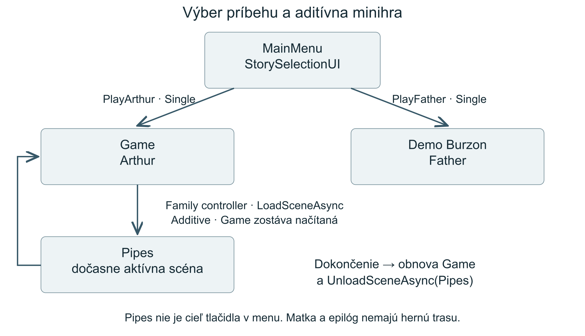
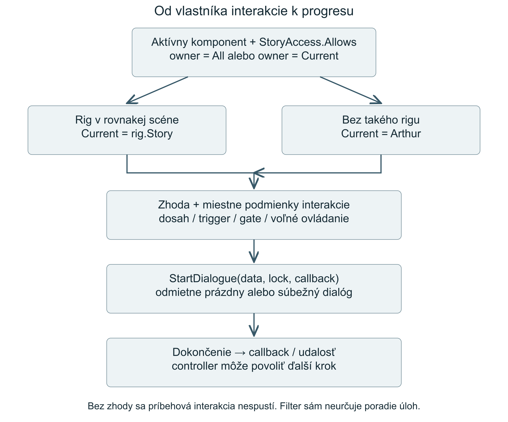
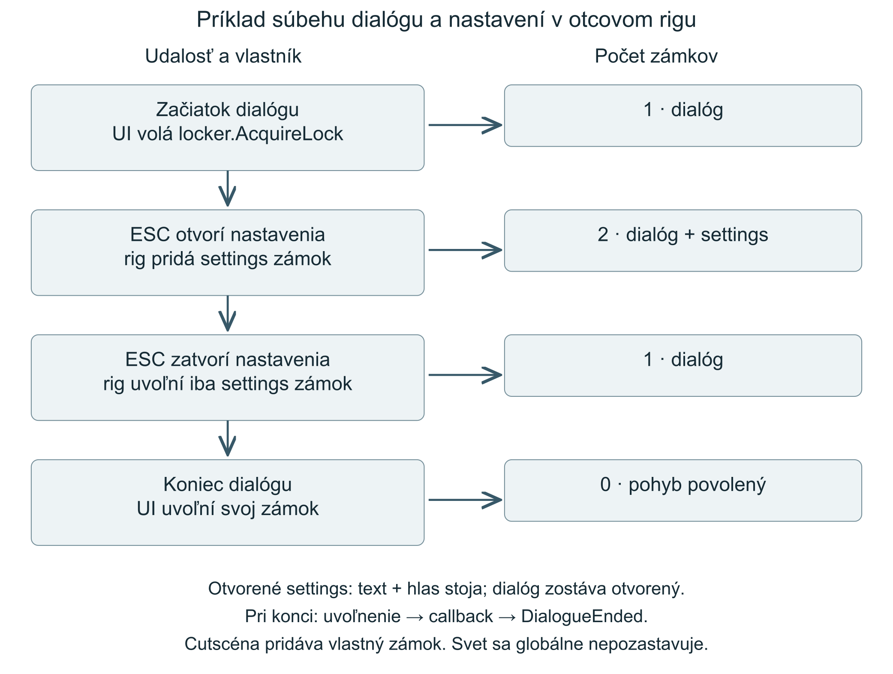

# The Visitor technická dokumentácia

**Obsah**

| Sekcia | Obsah |
| --- | --- |
| [1 Otvorenie a zostavenie projektu](#1-otvorenie-a-zostavenie-projektu) | Unity, Git LFS a build |
| [2 Priečinky a scény](#2-priečinky-a-scény) | Umiestnenie skriptov a účel scén |
| [3 Štart a navigácia za behu](#3-štart-a-navigácia-za-behu) | Menu, načítanie scén a služby |
| [4 Vlastníctvo príbehu a progres](#4-vlastníctvo-príbehu-a-progres) | StoryId, triggery a postup príbehu |
| [5 Pohyb kamery a zámky ovládania](#5-pohyb-kamery-a-zámky-ovládania) | Pohyb, kamery, kurzor a zámky |
| [6 Dialógy zvuk a ukladanie nastavení](#6-dialógy-zvuk-a-ukladanie-nastavení) | Dialógové dáta, audio a PlayerPrefs |
| [7 Minihry a návrat do hry](#7-minihry-a-návrat-do-hry) | Okno, puzzle, telefón a Pipes |
| [8 Postupy pri rozširovaní](#8-postupy-pri-rozširovaní) | Nový dialóg, interakcia a kamera |
| [9 Debugovanie](#9-debugovanie) | Skip nástroje, kontroly a riešenie problémov |

## 1 Otvorenie a zostavenie projektu

Projekt používa Unity **2022.3.47f1** ([ProjectVersion.txt](../ProjectSettings/ProjectVersion.txt)). V Unity Hub otvor koreň s priečinkami `Assets`, `Packages` a `ProjectSettings`.

1. Pred otvorením stiahni repozitár aj veľké súbory cez Git LFS. V koreňovom priečinku spusti nasledujúce príkazy.

```text
git lfs install
git lfs pull
```

2. Po importe skontroluj Console. Ak chýbajú modely alebo zvuky, over stiahnutie LFS súborov.
3. Otvor `Assets/_Project/Scenes/MainMenu.unity` a zapni Play. Arthur vedie do `Game`, otec do `Demo Burzon`. Priamy Play v `Demo Burzon` slúži na prácu na otcovi; priame otvorenie `Game` spúšťa Arthurov začiatok.
4. V Build Settings over poradie a zapnutie scén: `MainMenu`, `Game`, `Pipes`, `Demo Burzon`. Prvá scéna určuje štart player buildu. Zvoľ cieľovú platformu a potrebný modul editora, potom Build alebo Build And Run. Výstup ukladaj mimo `Assets`, napríklad do ignorovaného `Builds`.

Používané systémy: URP 14.0.11, TextMesh Pro 3.0.9 a UGUI 1.0.0. Ovládanie používa `Input.GetAxis` a `Input.GetKeyDown`, `activeInputHandler` je `Both`. Input System 1.7.0, Timeline, Visual Scripting a Test Framework sú nainštalované balíky; nie sú základom opísaného herného toku. Verzie sú v [manifest.json](../Packages/manifest.json).

[.gitattributes](../.gitattributes) posiela do LFS aj `.blend`, `.fbx`, `.clip`, zvukové a ďalšie veľké binárne formáty. Prenášaj `.meta` spolu s assetmi: referencie v scénach používajú GUID, nie iba názov súboru. `Library`, `Temp`, `Logs`, zostavenia a používateľské nastavenia sa nerevízujú.

## 2 Priečinky a scény

Herné skripty sú v `Assets/_Project/Scripts`: `Core` obsahuje načítanie scén a služby, `Gameplay` sekvencie a interakcie, `Input` napríklad `NPCInteractable`, `UI` dialógy a menu, `pipes` potrubnú minihru. Pohyb a rozhliadanie sú v `Assets/_Project/ThirdParty/FurnishedCabin/Scripts/Player`.

- `MainMenu`: výber príbehu, vstup do nastavení. `StorySelectionUI` má priradený `SceneLoader`, panel výberu a tlačidlá; `fatherSceneName` je serializované ako `Demo Burzon`.
- `Game`: pôvodný Arthurov príbeh so sekvenčnými controllermi a kamerovými prechodmi.
- `Demo Burzon`: pracovná scéna otca. Má `StoryPlayerRig` so `story = Father`, priradený locker, gameplay kameru a spawn. `managedCameras` momentálne obsahuje jednu kameru.
- `Pipes`: samostatná aditívne načítaná minihra. Pri samostatnom spustení nemá automaticky kontext návratu do príbehu.
- `Demo Chris`, `Demo Kiko`, `Demo Matej`, `Demo Samo`: samostatné kópie scén. Zmena objektu v jednej scéne automaticky neaktualizuje ostatné. Zmena spoločného skriptu môže ovplyvniť všetky jeho použitia.
- `Bootstrap` a `Test`: existujúce scény mimo aktuálneho zapnutého zoznamu pre build.

## 3 Štart a navigácia za behu



`StorySelectionUI.PlayArthur()` volá `SceneLoader.LoadGameScene()`, ktorý používa serializované `gameSceneName = Game`. `PlayFather()` volá `LoadScene(fatherSceneName)`. `SceneLoader` používa synchrónne `SceneManager.LoadScene` v režime Single.

`GameBootstrap` je prázdny komponent. V rovnakom súbore je však funkčný `GameplayMusicController`. Ten a `AudioSettingsOverlay` sa vytvárajú automaticky cez `RuntimeInitializeOnLoadMethod(BeforeSceneLoad)` a prežívajú zmenu scén cez `DontDestroyOnLoad`. `DialogueUI` je naopak scénový singleton.

Načítanie `MainMenu` alebo `Game` spúšťa úvodnú hudbu. Otcova scéna nemá v tejto vetve samostatne určenú skladbu; pri prechode sa môže zachovať predchádzajúca hudba. Ďalšie zmeny hudby vyvolávajú konkrétne sekvencie.

Zdroj: [SceneLoader](../Assets/_Project/Scripts/Core/SceneLoader.cs), [StorySelectionUI](../Assets/_Project/Scripts/UI/StorySelectionUI.cs), [GameBootstrap a hudobná služba](../Assets/_Project/Scripts/Core/GameBootstrap.cs).

## 4 Vlastníctvo príbehu a progres



`StoryId` má hodnoty `All = 0`, `Arthur = 1`, `Father = 2`, `Mother = 3`, `Epilogue = 4`. `StoryAccess.Current(source)` použije `StoryPlayerRig.Instance.Story` len vtedy, ak rig a zdrojový komponent patria do rovnakej scény. Inak vráti `Arthur`. `Allows(source, owner)` povolí `All` alebo zhodu s aktuálnym príbehom.

Fallback na Arthur zachováva správanie scén bez rigu. Platí aj pre komponent v inej aditívnej scéne; výber príbehu nie je globálny.

Pôvodné intro, okno, puzzle, telefón, rodinná minihra, dialóg pri dverách, relay a NPC majú predvolene vlastníka Arthur. `DoorTriggerRotator` má `All`, takže fyzické dvere môžu byť spoločné; Arthurova hudobná reakcia je osobitne podmienená. Otcov obraz a chladnička majú Father. Kontroly zahŕňajú aj `isActiveAndEnabled`, dôležité najmä pri fyzikálnych callbackoch. Pri inicializácii sa vlastníctvo kontroluje samostatne a niektoré pôvodné controllery sledujú `storyInitialized`, aby cleanup cudzieho príbehu nemenil jeho prezentáciu.

### Arthurova sekvencia

`OpeningGhostIntroController` koordinuje úvod, kamery, relays a postupné povoľovanie ďalších systémov. Zjednodušený skutočný tok je:

1. Úvodné dialógy, telefón a zjavenie ducha; následne návrat na gameplay kameru a uvoľnenie úvodného zámku.
2. Dialóg pri okne povolí `WindowSequenceController`; dokončenie okna pripraví dialóg pri obraze.
3. Dokončenie dialógu pri obraze pokračuje k puzzle. Ak je priradený samostatný puzzle trigger, čaká sa naň; úvodný dialóg môže sprostredkovať `PuzzleEventDirector`.
4. Dokončený post-puzzle tok odomkne dvere a ich dialóg. Samotné poskladanie posledného dielika ešte nie je koniec celej nadväzujúcej sekvencie.
5. Dokončenie dialógu dverí povolí rodinnú minihru a otvorí jej sekvenciu. Po návrate môže controller vyvolať `PlayFinalBedEnding` a existujúcu záverečnú prezentáciu.

### Otcove prototypy

`FatherReflectionInteractable` ponúka opakovateľnú interakciu s obrazom. Vyžaduje rig, dialóg, voľné ovládanie a dostupné `DialogueUI`. Kontroluje dosah približne 2,8 m, smer pohľadu cez dot produkt nad 0,5 a raycast bez triggerov. Po dokončení zabráni opätovnému spusteniu v rovnakom frame. Dialóg si vyžiada zámok ovládania.

`FatherFridgeInteractable.TryTakeBeer()` pri úspechu nastaví `HasTakenBeer`, ukáže spätnú väzbu na 2,5 sekundy a vyvolá `onBeerTaken`. Vo scéne je tento UnityEvent prázdny. `focusPoint` nie je priradený, preto sa používa stred `fridgeRenderer.bounds`. Obidve interakcie používajú rovnaký rig.

Chladnička nemá animované otvorenie, inventár, fyzické pivo, pitie ani príbehový dôsledok. Jednorazovosť platí pre život konkrétneho komponentu: opätovné načítanie scény ju resetuje.

Zdroje: [StoryAccess](../Assets/_Project/Scripts/Gameplay/StoryAccess.cs), [obraz](../Assets/_Project/Scripts/Gameplay/FatherReflectionInteractable.cs), [chladnička](../Assets/_Project/Scripts/Gameplay/FatherFridgeInteractable.cs).

## 5 Pohyb kamery a zámky ovládania

`PlayerMove` používa `CharacterController.SimpleMove` a staré vstupné osi. `PlayerLook` rieši citlivosť a vertikálny limit pohľadu. Otcov `StoryPlayerRig` riadi výber kamery a kurzor; na jeho `PlayerLook` musí byť zapnuté `externalCursorOwner`, inak môžu dva komponenty meniť kurzor súčasne.

Otec používa rig; Arthur má vlastné sekvenčné kamerové controllery.

Rig pri štarte voliteľne premiestni hráča na `spawnPoint`, pričom dočasne vypne CharacterController. `SelectCamera` zapína kameru a jej AudioListener iba medzi položkami `managedCameras`; neupravuje kamery mimo zoznamu. `BeginCutscene(camera)` odmietne neaktívnu alebo nezaregistrovanú kameru. `EndCutscene()` vráti gameplay kameru. Nie je tu zásobník vnorených cutscén ani podpora viacerých súčasných rigov.

`PlayerControlLocker` má počítadlo. `AcquireLock()` ho zvýši, `ReleaseLock()` zníži a pohyb sa obnoví až pri nule. Zoznam `behavioursToDisable` v otcovej scéne obsahuje dva ovládacie komponenty. Locker si nepamätá ich pôvodný stav enabled: pri odomknutí ich zapne. Nedávaj sem komponent, ktorý má zostať vypnutý, samotný rig, UI ani správcu zámkov.



Dialóg, nastavenia a cutscéna vlastnia oddelené prírastky toho istého počítadla. Rig má pre nastavenia a cutscénu samostatné boolean príznaky, aby opakované otvorenie nepridávalo ďalšie zámky. Bežná dokončovacia vetva smie uvoľniť iba vlastný zámok. `ClearLocks()` nie je náhrada za párové uvoľnenie; zrušil by aj cudzích vlastníkov.

ESC môže otvoriť nastavenia aj počas dialógu. UI zastaví písanie textu, posúvanie replík a práve prehrávaný hlas, ktorý potom samo obnoví. Dialóg zostáva otvorený a jeho zámok zostáva aktívny. Pri zatvorení nastavení sa uvoľní iba settings zámok. Pri dokončení dialógu sa najprv uvoľní jeho zámok, potom sa zavolá completion callback a následne `DialogueEnded`.

Nastavenia nepozastavujú celú hru. `Time.timeScale` sa nemení, svetové animácie a ostatné coroutine môžu pokračovať. Na legacy ceste bez otcovho rigu nastavenia samy negarantujú zámok `PlayerMove`; `PlayerLook` otvorené nastavenia rešpektuje. Ani všetky minihry nemajú univerzálnu blokáciu vstupu pri nastaveniach.

V `Game` sa otvorenie nastavení blokuje počas otvoreného alebo prechádzajúceho puzzle a otvoreného okna, ale otvorený dialóg má v tejto kontrole prednosť. Povolené názvy scén sú `MainMenu`, `Game`, `Pipes`; existujúci rig povolí overlay aj v otcovej scéne.

Zdroje: [StoryPlayerRig](../Assets/_Project/Scripts/Gameplay/StoryPlayerRig.cs), [PlayerControlLocker](../Assets/_Project/Scripts/Gameplay/PlayerControlLocker.cs), [AudioSettingsOverlay](../Assets/_Project/Scripts/UI/AudioSettingsOverlay.cs).

## 6 Dialógy zvuk a ukladanie nastavení

`DialogueData` je ScriptableObject vytváraný cez `Create > Dialogue > Conversation`. Každý riadok obsahuje `speakerName`, `text`, `side` a voliteľný `voiceClip`. Hlasy sa prehrávajú z pripravených AudioClipov.

`DialogueUI.StartDialogue(data, true, callback)` vracia úspech prijatia. Odmietne prázdne dáta aj ďalší rozhovor počas otvoreného dialógu; neexistuje fronta. Ak chýba locker, dialóg môže začať s varovaním, ale požadovaný zámok nebude fungovať. E najprv dokončí rozpisovaný text, ďalšie E pokračuje. `AcquireAdvanceInputLock()` blokuje posun replík nezávisle od pohybového zámku.

`DialogueUI` potrebuje referencie na skupiny a TMP texty dialógu/promptu a pre zamykanie `playerControlLocker`. Hlasový AudioSource sa používa pre jednotlivé voice clipy; nová replika zastaví predchádzajúci hlas. `SetPromptVisible(owner, ...)` bráni cudziemu vlastníkovi schovať prompt, ale neposkytuje prioritu viacerých súčasne dostupných interakcií: posledný zápis môže vyhrať.

Hudobná služba používa dve hudobné AudioSources na prechody a samostatný one-shot zdroj. Skladby načítava z `Resources/Audio/Music/`, napríklad `main_menu-music`, `ghost-first`, `Ambiance_Forest_Birds_Loop_Stereo`, `family-separation`, `ending after las game`. Názvy sú kľúče Resources bez prípony. Chýbajúci clip vytvorí warning.

Overlay registruje zdroje cez `RegisterMusicSource` alebo `RegisterSfxSource`. Hlasy patria do SFX, nemajú samostatný voice slider. Master mení `AudioListener.volume`; kanálové nastavenia menia registrované zdroje. Pri pridaní nového AudioSource treba overiť jeho registráciu a výslednú hlasitosť, nie iba nastaviť slider v UI.

Kľúče PlayerPrefs a ich hodnoty:

- `AudioSettings.MasterVolume`: predvolená hodnota 1.
- `AudioSettings.MusicVolume`: predvolená hodnota 0,25.
- `AudioSettings.SfxVolume`: predvolená hodnota 1.
- `InputSettings.MouseSensitivity`: predvolená hodnota 100, rozsah 25 až 800; slider používa logaritmické mapovanie.

Settery ukladajú hodnoty cez `PlayerPrefs.Save()`. Default sa použije iba bez uloženej preferencie, takže zmena defaultu neprepíše staršiu citlivosť. Postup príbehu, rozhodnutia a `HasTakenBeer` sa neukladajú. Matkin príbeh a spoločný epilóg ešte nie sú implementované.

Zdroj: [DialogueUI](../Assets/_Project/Scripts/UI/DialogueUI.cs), [AudioSettingsOverlay](../Assets/_Project/Scripts/UI/AudioSettingsOverlay.cs), [PlayerLook](../Assets/_Project/ThirdParty/FurnishedCabin/Scripts/Player/PlayerLook.cs).

## 7 Minihry a návrat do hry

### Okno

`WindowSequenceController` má sedem hotspotov, posun panorámy a vstup šípkami alebo A/D. Riadi kamerový prechod, kurzor, dostupnosť interakcie a zámok. Dokončenie pokračuje cez dialóg a uzavretie sekvencie k `SequenceCompleted`, na ktorý nadväzuje intro controller. Nie je to samostatne načítaná scéna.

### Puzzle a telefón

`PuzzleOpener` otvára puzzle cez E, uzatvára cez ESC a ukladá/obnovuje pohľad. `PuzzleManagerUI` predvolene používa mriežku 5 × 4 a snap vzdialenosť 55 v UI súradniciach. Počíta správne umiestnené dieliky; prahy 5, 10 a 15 vyvolajú udalosti len raz a musia byť menšie než počet dielikov. Všetky správne dieliky vyvolajú `PuzzleSolved` a zamknú vstup puzzle.

`PuzzleEventDirector` pripája úvod, prerušenia telefónom a post-puzzle tok. Pri prerušení zamkne puzzle, prepne pohľad a prezentáciu na telefón, spustí `PhoneInterruptionHandler` a čaká na dokončenie. Potom sa vráti na puzzle a odomkne ho. Telefón obsahuje scrollovanie cez S, písanie odpovede `no clue` s Enter a reakcie cez Q podľa scenára. Po vyriešení puzzle pokračujú ďalšie dialógy a návrat; až potom sa hlási dokončenie post-puzzle toku.

### Rodina a Pipes

`FamilyMinigamePlaceholderController` vie načítať `Pipes` cez `LoadSceneAsync(..., Additive)`. Presunie korene načítanej scény o predvolený offset `(10000, 0, 0)`, dočasne vypne kamery, listenery a EventSystems mimo minihry a nastaví `Pipes` ako aktívnu scénu. Pri návrate obnoví prezentáciu, nastaví pôvodnú scénu aktívnou a minihru vyloží. Ak sa nepoužije načítaná scéna, controller má aj náhradnú prezentačnú vetvu.

`PipeTile` sa otáča po 90 stupňoch. `GridManager` nekontroluje prietok ani spojitosť potrubia: porovnáva cieľovú rotáciu skutočných dielikov. Straight akceptuje index 0 alebo 2, Other index 0; `isReal = false` sa nepočíta. Musí existovať aspoň jeden skutočný dielik. Po úspechu skúsi `TryCompleteActiveSceneMinigame()`; bez aktívneho rodinného controllera použije `GameManager.instance.Win()`, ktorý iba vypíše `LEVEL COMPLETE`.

Globálne vyhľadávanie `PipeTile` a statický aktívny controller predpokladajú jednu minihru naraz. Návrat po dokončení môže pokračovať do Arthurovho záveru cez priradený intro controller alebo cez lokálne dokončovacie dialógy. 

Zdroje: [okno](../Assets/_Project/Scripts/Gameplay/WindowSequenceController.cs), [puzzle](../Assets/_Project/Scripts/Gameplay/PuzzleOpener.cs), [director](../Assets/_Project/Scripts/Gameplay/PuzzleEventDirector.cs), [rodinná minihra](../Assets/_Project/Scripts/Gameplay/FamilyMinigamePlaceholderController.cs).

## 8 Postupy pri rozširovaní

### Pridanie rozhovoru

1. Vytvor `DialogueData`, vyplň riadky a priraď importované voice clipy. Prázdne pole riadkov sa nespustí; chýbajúci voice clip môže zostať tichý.
2. Over scénové `DialogueUI`, jeho textové referencie a ten istý locker, ktorý používa hráč. Asset priraď do konkrétnej interakcie v Inspectore.
3. Pri volaní z kódu kontroluj návratovú hodnotu. Stav „rozhovor vybavený“ nenastavuj pred prijatím požiadavky. Dokončenie pripájaj cez callback, nie odhad trvania zvuku.

```csharp
bool started = DialogueUI.Instance != null &&
    DialogueUI.Instance.StartDialogue(dialogue, true, OnConversationFinished);
// OnConversationFinished je callback novej interakcie.
```

4. Otestuj E počas písania, dokončenie poslednej repliky a ESC uprostred hlasu. Callback nesmie zrušiť cudzie zámky ani neúmyselne spustiť tú istú interakciu v tom istom frame.

### Priradenie vlastníka a novej interakcie

Priraď `story` konkrétnej perspektíve; `All` používaj len pre zámerne zdieľané správanie. Všetky verejné vstupy aj trigger callbacky majú kontrolovať aktívnosť a `StoryAccess.Allows(this, story)`, nielen `Update`. Pri preberaní starého controllera prever aj Awake, OnEnable, OnDisable a udalosti: nestačí zastaviť jeho dialóg, ak ešte mení kamery alebo objekty.

Pri triggeri priraď správny collider, relay, hráča a cieľový controller podľa existujúceho zapojenia. Dynamicky vytvorený `PlayerTriggerRelay` má vlastný predvolený príbeh Arthur; zmena vlastníka nadradeného controllera sa automaticky neprenesie do relay. Nekonfiguruj preto generický nový príbeh iba zmenou jedného enumu.

Pre jednoduchú otcovu interakciu použi vzor obrazu/chladničky: rig, focus point, dosah, smer pohľadu, kontrola zakrytia a blokácia počas dialógu/nastavení. Focus point za stenou alebo raycast zasiahnutý cudzím colliderom môže správne zabrániť interakcii. Pri chladničke možno neskôr pripojiť animáciu/zvuk na `onBeerTaken`; to samo nevytvorí uložené rozhodnutie ani inventár.

### Nastavenie kamery príbehu

1. Na hráča priraď `StoryPlayerRig` s príslušným StoryId, `controlLocker`, `gameplayCamera` a voliteľným spawn pointom. Chýbajúci locker nie je podporovaná konfigurácia.
2. Do `managedCameras` vlož gameplay kameru aj každú cutscene kameru, ktorú bude rig prepínať. Listener patrí na spravovanú kameru. Skontroluj aj nespravované kamery v scéne.
3. V lockeri nechaj ovládacie Behaviours a v `PlayerLook` nastav `externalCursorOwner`. Pre novú kameru použi `BeginCutscene(camera)` a po jej skončení `EndCutscene()`.
4. V Play Mode over jedinú aktívnu kameru/listener, otváranie nastavení počas rozhovoru a návrat po cutscéne. Pri zatvorení nastavení uprostred dialógu sa hráč ešte nesmie začať hýbať.

## 9 Debugovanie

Použitie F7, F8, menu `Tools > The Visitor > Debug` a pôvodných backtick skratiek opisuje [debug-skips.md](debug-skips.md), vrátane checklistu odstránenia pred vydaním. F7 dokončuje rozhovor cez bežné callbacky; F8 povoľuje aktívne interakcie správneho príbehu, neoznačuje puzzle za vyriešené. Debug neaktivuje vypnuté objekty a neobnovuje spotrebované one-shot triggery.

Skratky sú dostupné iba v Editore (`UNITY_EDITOR`). Pred vydaním ich odstráň podľa checklistu; zachovaj dokončovacie metódy používané gameplayom.

`StoryDebugTools.IsBusy` číta stav cez `SerializedObject.FindProperty`, ktoré nemusí nájsť neserializované privátne polia. Pred odomknutím minihru manuálne zatvor; táto ochrana nie je spoľahlivo overená.

### Praktická kontrola zmeny

- Spusti obe cesty z menu a potom priamy Play v `Demo Burzon`. Over správnu perspektívu, jednu kameru/listener a Console bez nových chýb.
- V otcovej scéne prejdi Arthurovým dverným triggerom; nemá zaznieť jeho replika. Over obraz zblízka, z diaľky a cez prekážku, potom jednorazové pivo a reset po znovunačítaní scény.
- V dialógu otvor/zatvor nastavenia. Text a hlas sa obnovia, E počas settings neposunie repliku, ovládanie sa vráti až po poslednom vlastníkovi zámku.
- V Arthurovi prejdi okno, puzzle s telefónom, dvere a rodinu bez skipov. Pri Pipes over aktívnu scénu, návrat kamery, listenera a EventSystemu.
- Zmeň hlasitosť a citlivosť, reštartuj hru a over zachovanie. Osobitne over nové preferencie, aby uložené hodnoty nezakryli defaulty.
- Pred distribúciou sprav samostatný build, over dostupné scény a absenciu debug skratiek. Editorový smoke test nenahrádza build.

### Časté problémy

Ak interakcia nereaguje, najprv skontroluj StoryId, enabled/active stav, rig v rovnakej scéne, referencie, dosah a otvorený dialóg. Ak ovládanie zostalo zamknuté, hľadaj nevyvážené Acquire/Release a nedokončený callback; plošné `ClearLocks()` môže skryť príčinu. Dve kamery alebo listenery znamenajú často neúplné `managedCameras` alebo starý controller. Ak nepočuť hlas, over clip, registráciu zdroja, SFX/master a stav settings pause. Pri chýbajúcej scéne v builde porovnaj názov v Inspectore so zapnutými Build Settings.
